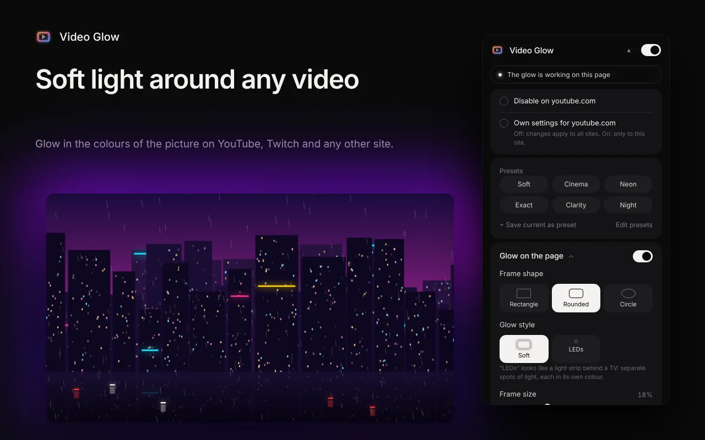
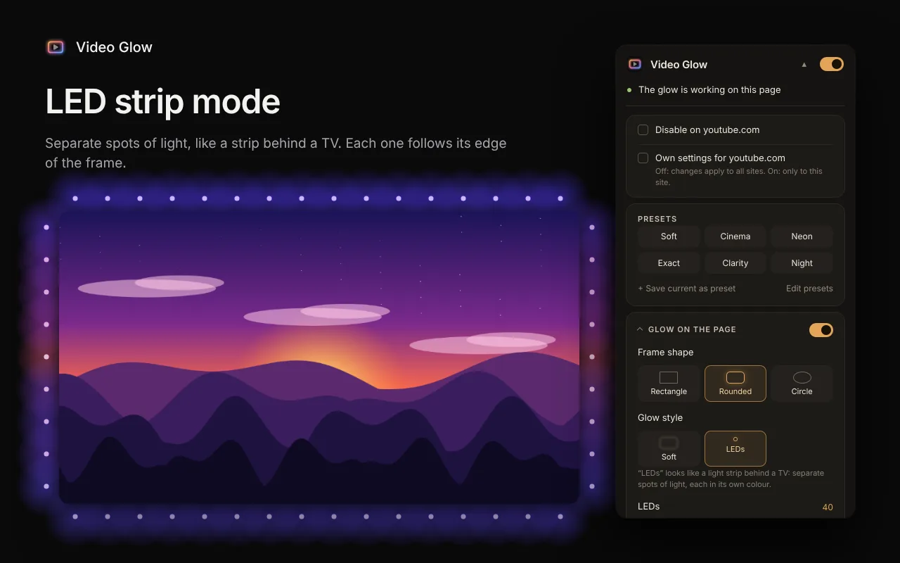
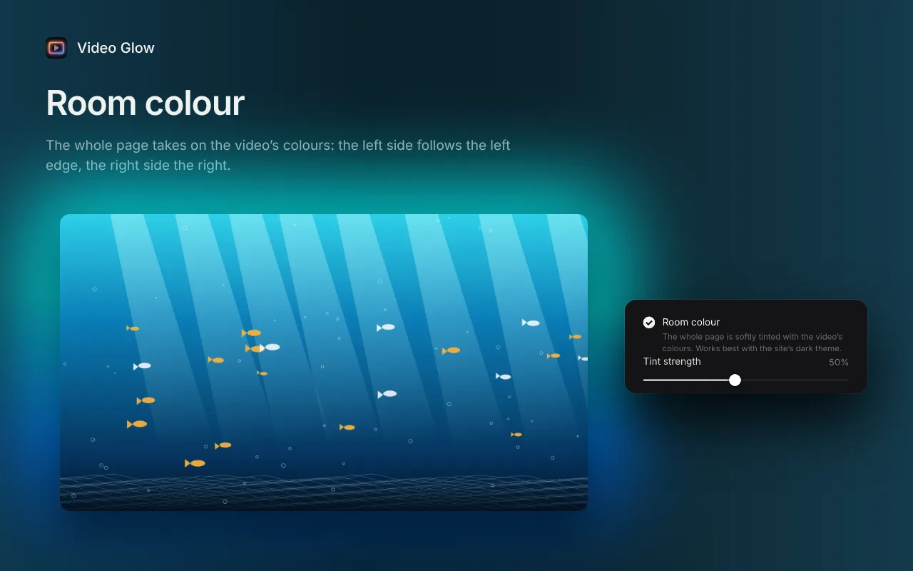
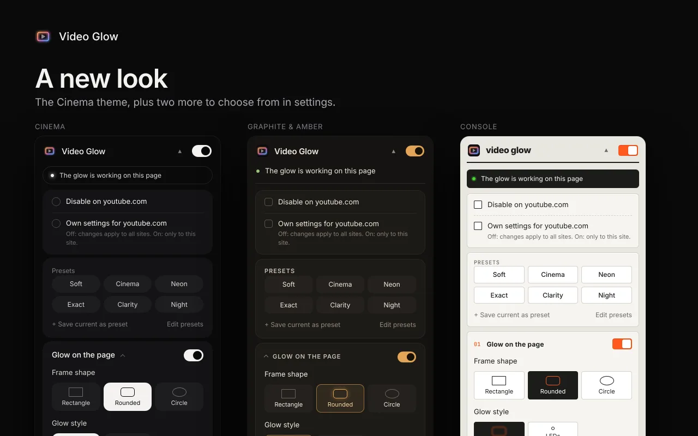

<h1 align="center">Video Glow</h1>

<b>Ambient light for any video in your browser</b> 
English · <a href="README.ru.md">Русский</a> · <a href="README.uk.md">Українська</a>

Video Glow turns your screen into a small home cinema: a soft light in the colours of the picture appears around any HTML5 video. It works on YouTube, Twitch and any other site, also in fullscreen. Free, no account needed.

## Install

- **Chrome, Edge, Brave, Opera:** [Chrome Web Store](https://chromewebstore.google.com/detail/bjgbalkabocifimhnhbcnomeknpbhkea)
- **Firefox:** [Firefox Add-ons](https://addons.mozilla.org/firefox/addon/video-glow/)
- **Manual install:** zip files for Chrome and Firefox on the [Releases](../../releases) page

## Features

- Works on any site, in iframes and in fullscreen (fills the black bars on 16:10 and ultrawide screens)
- Two styles: soft blur or an LED strip, where every spot follows the colour of its edge of the frame
- Room colour: the whole page is tinted in the colours of the video
- Shape, size, edge softness, blur, brightness and saturation are adjustable
- Smooth fade on play and pause, auto-detection of black bars baked into movies
- Picture filters, night comfort, flash protection, glow to the beat of the sound
- Cinema mode, an on/off button on the video, per-site settings, hotkeys, backup
- Six interface themes; English, Deutsch, Español, Polski, Português (Brasil), Türkçe, Русский, Українська

| LED strip | Room colour | Themes |
|---|---|---|
|  |  |  |

## Privacy

Video Glow collects no data and sends nothing anywhere: everything runs on your device. [Privacy policy](https://vkardin.github.io/video-glow/privacy.html).

## Feedback and support

- Ideas and bug reports: [feedback page](https://vkardin.github.io/video-glow/support.html) or [GitHub Issues](../../issues/new/choose)
- Support the project with crypto: [https://vkardin.github.io/video-glow/#donate](https://vkardin.github.io/video-glow/#donate)

## Repository

| Folder | What is inside |
|---|---|
| [`extension/`](extension) | Extension source (load via `chrome://extensions` → Developer mode → Load unpacked) |
| [`docs/`](docs) | Website, served by GitHub Pages |
| [`store/`](store) | Store listing texts, graphics and test scripts |
| [`tools/`](tools) | `build.py` packs the Chrome and Firefox zips |

## More from the author

- [Leveler](https://vkardin.github.io/leveler/): a free Chrome and Firefox extension that evens out the loudness of any video: quiet dialogue louder, explosions softer.
- [Snapt](https://vkardin.github.io/snapt/): a fast, open-source screenshot tool for Windows, macOS and Linux.

## License

[MIT](LICENSE) © vkardin
