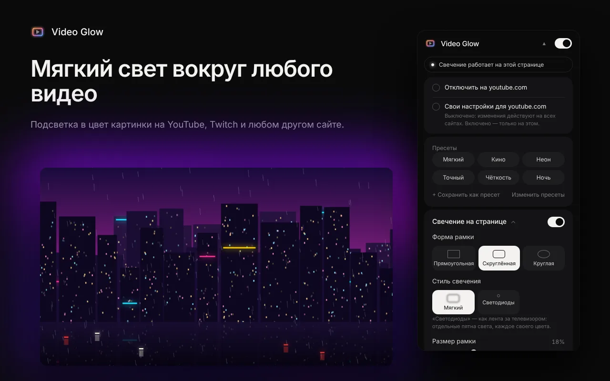
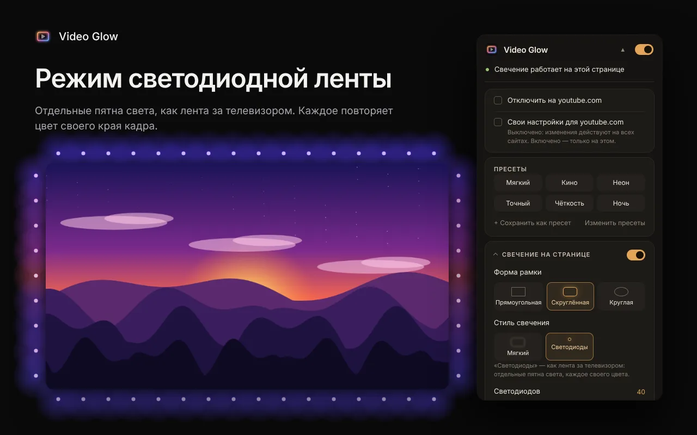
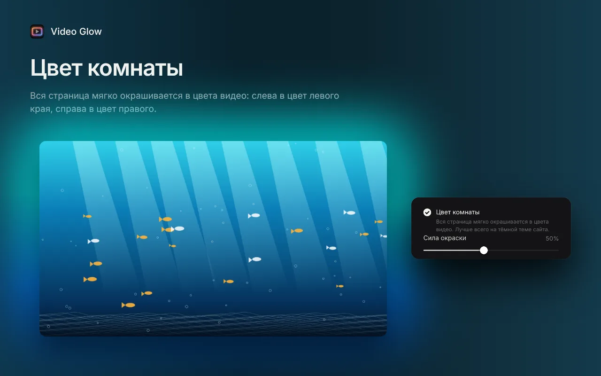
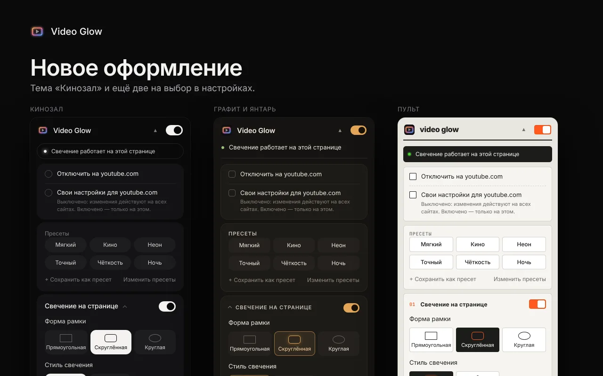

<h1 align="center">Video Glow</h1>

<b>Подсветка для любого видео в браузере</b> 
<a href="README.md">English</a> · Русский · <a href="README.uk.md">Українська</a>

Video Glow превращает экран в маленький кинозал: вокруг любого HTML5-видео загорается мягкий свет в цвет картинки. Работает на YouTube, Twitch, VK Видео и на любом другом сайте, в том числе в полноэкранном режиме. Бесплатно, без аккаунтов.

## Установка

- **Chrome, Edge, Brave, Opera:** [Chrome Web Store](https://chromewebstore.google.com/detail/bjgbalkabocifimhnhbcnomeknpbhkea)
- **Firefox:** [Firefox Add-ons](https://addons.mozilla.org/firefox/addon/video-glow/)
- **Вручную:** zip-архивы для Chrome и Firefox на странице [Releases](../../releases)

## Возможности

- Любые сайты, видео в iframe и полноэкранный режим (заливает чёрные полосы на экранах 16:10 и ультрашироких)
- Два стиля: мягкое размытие или светодиодная лента, где каждое пятно повторяет цвет своего края кадра
- Цвет комнаты: вся страница мягко окрашивается в цвета видео
- Настраиваются форма, размер, мягкость края, размытие, яркость и насыщенность
- Плавное появление и затухание при паузе, автоопределение чёрных полос, вшитых в фильм
- Фильтры видео, ночной комфорт, защита от вспышек, свечение в такт звуку
- Режим кинотеатра, кнопка вкл/выкл на видео, свои настройки для каждого сайта, горячие клавиши, резервная копия
- Шесть тем оформления; English, Deutsch, Español, Polski, Português (Brasil), Türkçe, Русский, Українська

| Светодиодная лента | Цвет комнаты | Темы |
|---|---|---|
|  |  |  |

## Конфиденциальность

Расширение не собирает данные и никуда ничего не отправляет: всё работает на вашем устройстве. [Политика конфиденциальности](https://vkardin.github.io/video-glow/privacy.html).

## Обратная связь и поддержка

- Идеи и ошибки: [страница обратной связи](https://vkardin.github.io/video-glow/support.html) или [GitHub Issues](../../issues/new/choose)
- Поддержать проект криптовалютой: [https://vkardin.github.io/video-glow/#donate](https://vkardin.github.io/video-glow/#donate)

## Что в репозитории

| Папка | Что внутри |
|---|---|
| [`extension/`](extension) | Исходный код расширения (`chrome://extensions` → Режим разработчика → Загрузить распакованное) |
| [`docs/`](docs) | Сайт, публикуется через GitHub Pages |
| [`store/`](store) | Тексты для магазинов, графика и тестовые скрипты |
| [`tools/`](tools) | `build.py` собирает zip для Chrome и Firefox |

## Ещё от автора

[Leveler](https://vkardin.github.io/leveler/) — бесплатное расширение для Chrome и Firefox, которое выравнивает громкость любого видео: тихие диалоги громче, взрывы тише.

## Лицензия

[MIT](LICENSE) © vkardin
