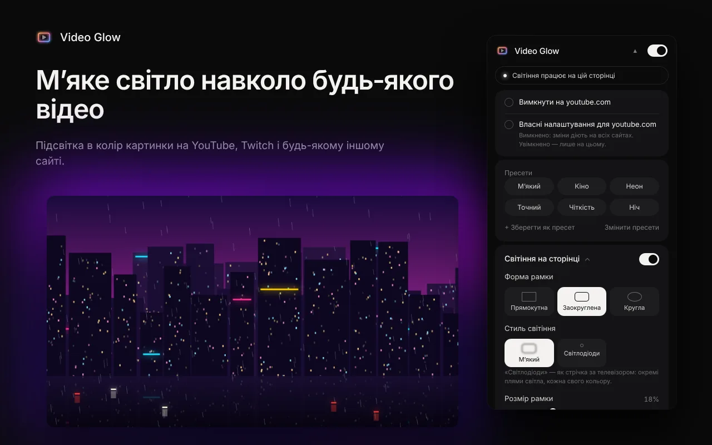
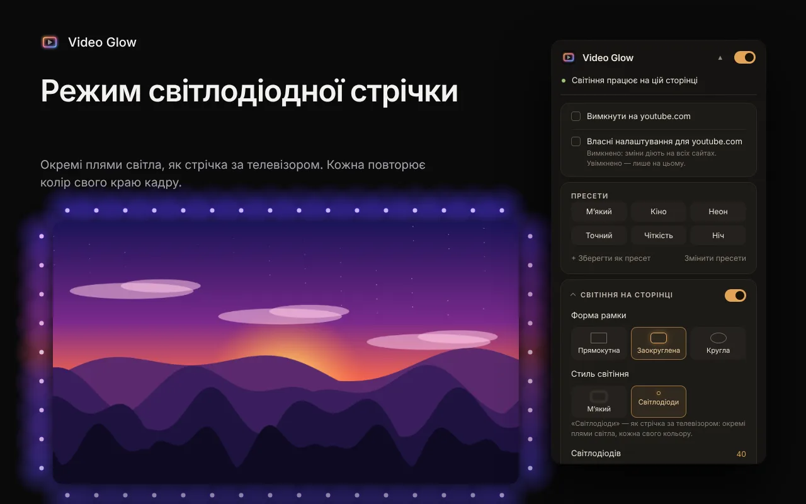
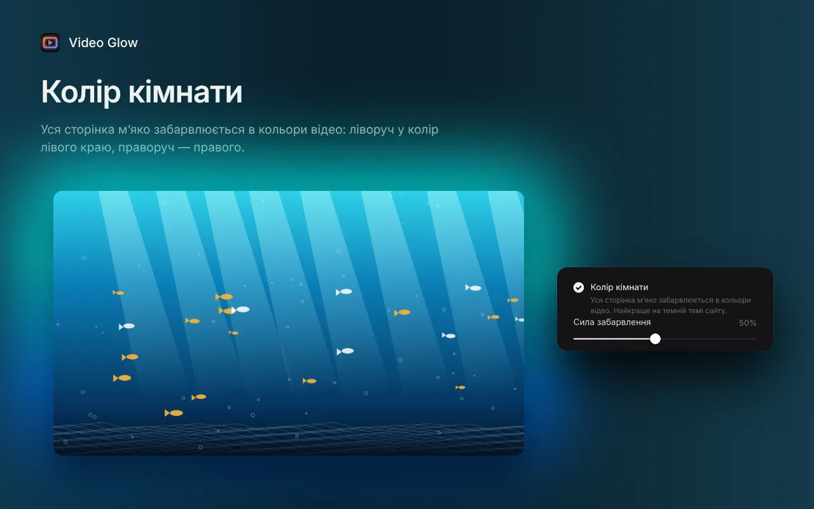
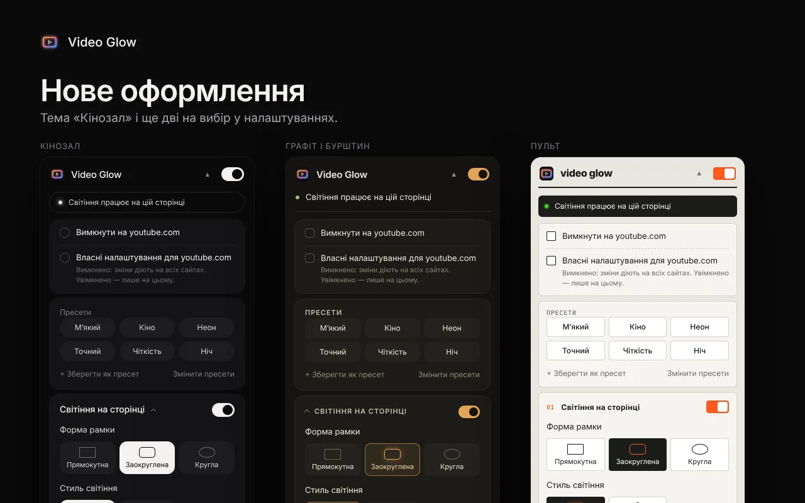

<h1 align="center">Video Glow</h1>

<b>Підсвітка для будь-якого відео в браузері</b> 
<a href="README.md">English</a> · <a href="README.ru.md">Русский</a> · Українська

Video Glow перетворює екран на маленький кінозал: навколо будь-якого HTML5-відео спалахує м’яке світло в колір картинки. Працює на YouTube, Twitch та будь-якому іншому сайті, зокрема в повноекранному режимі. Безкоштовно, без акаунтів.

## Встановлення

- **Chrome, Edge, Brave, Opera:** [Chrome Web Store](https://chromewebstore.google.com/detail/bjgbalkabocifimhnhbcnomeknpbhkea)
- **Firefox:** [Firefox Add-ons](https://addons.mozilla.org/firefox/addon/video-glow/)
- **Вручну:** zip-архіви для Chrome і Firefox на сторінці [Releases](../../releases)

## Можливості

- Будь-які сайти, відео в iframe і повноекранний режим (заливає чорні смуги на екранах 16:10 та ультрашироких)
- Два стилі: м’яке розмиття або світлодіодна стрічка, де кожна пляма повторює колір свого краю кадру
- Колір кімнати: уся сторінка м’яко забарвлюється в кольори відео
- Налаштовуються форма, розмір, м’якість краю, розмиття, яскравість і насиченість
- Плавна поява і згасання під час паузи, автовизначення чорних смуг, вшитих у фільм
- Фільтри відео, нічний комфорт, захист від спалахів, сяйво в такт звуку
- Режим кінотеатру, кнопка вкл/викл на відео, власні налаштування для кожного сайту, гарячі клавіші, резервна копія
- Шість тем оформлення; English, Deutsch, Español, Polski, Português (Brasil), Türkçe, Русский, Українська

| Світлодіодна стрічка | Колір кімнати | Теми |
|---|---|---|
|  |  |  |

## Конфіденційність

Розширення не збирає даних і нікуди нічого не надсилає: усе працює на вашому пристрої. [Політика конфіденційності](https://vkardin.github.io/video-glow/privacy.html).

## Зворотний зв’язок і підтримка

- Ідеї та помилки: [сторінка зворотного зв’язку](https://vkardin.github.io/video-glow/support.html) або [GitHub Issues](../../issues/new/choose)
- Підтримати проєкт криптовалютою: [https://vkardin.github.io/video-glow/#donate](https://vkardin.github.io/video-glow/#donate)

## Що в репозиторії

| Тека | Що всередині |
|---|---|
| [`extension/`](extension) | Вихідний код розширення (`chrome://extensions` → Режим розробника → Завантажити розпаковане) |
| [`docs/`](docs) | Сайт, публікується через GitHub Pages |
| [`store/`](store) | Тексти для магазинів, графіка й тестові скрипти |
| [`tools/`](tools) | `build.py` збирає zip для Chrome і Firefox |

## Ліцензія

[MIT](LICENSE) © vkardin
